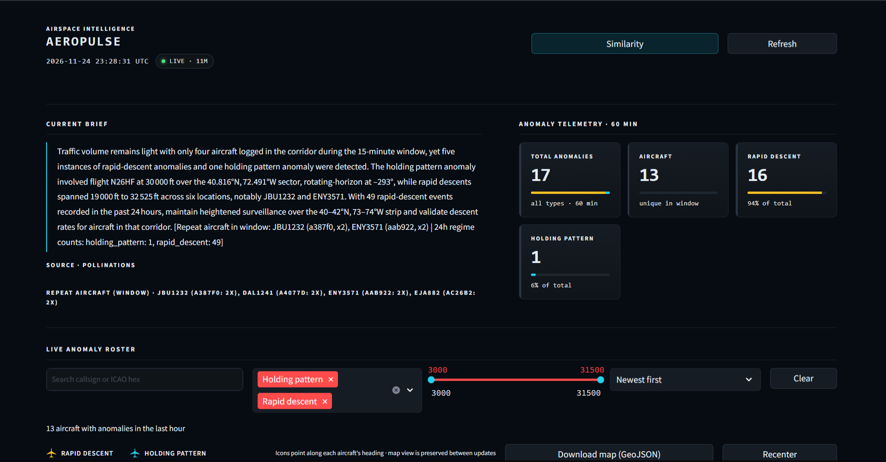
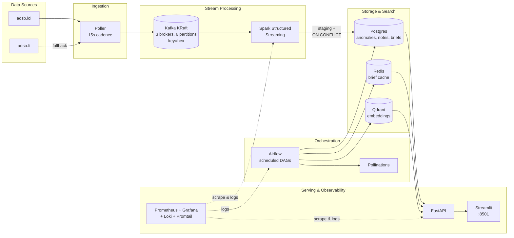

# AeroPulse

Real-time airspace intelligence from live ADS-B data — streaming anomaly detection, vector similarity search, LLM-generated operational briefs, full observability, and a searchable map dashboard for air traffic monitoring.



---

## Overview

AeroPulse ingests live aircraft positions from community ADS-B networks within ~100 nautical miles of JFK, processes them through a streaming pipeline that detects emergency squawks, rapid descents, and holding patterns, and serves an operational picture through an API, dashboard, and observability stack.

The system is built on four core principles:

- **Deterministic detection.** Detection logic is pure, bounded, and unit-tested. No ML, no heuristics that can't be expressed as thresholds an operator can reason about.
- **At-least-once delivery with exactly-once semantics at rest.** Every stage that writes to durable storage is idempotent. Recovery from restarts is a no-op, not a duplicate-write problem.
- **LLM as narrator, not decider.** Natural language summarisation sits strictly downstream of the pipeline. Detection works with the LLM offline; only the narrative text degrades.
- **Explicit failure modes.** Rate limits, provider outages, and stale caches surface as visible state (a `provider` column, a `stale` flag, a warning banner) rather than silent failures.

---

## Architecture



Positions flow left to right: source → ingestion → stream → storage → serving. Airflow runs orthogonally on a schedule, reading recent anomalies, calling the configured LLM provider, and writing narrative output back to Postgres, Redis, and Qdrant. Prometheus, Grafana, Loki, and Promtail provide metrics scraping, alerting rules, and centralized container logs.

Detailed subsystem internals and day-2 operational runbooks live in [docs/ARCHITECTURE.md](docs/ARCHITECTURE.md) and [docs/OPERATIONS.md](docs/OPERATIONS.md).

---

## Getting Started

```bash
git clone https://github.com/elmilouaysaad/AeroPulse.git
cd AeroPulse
cp .env.example .env      # configure secrets and ports (chmod 600 .env)
docker compose up -d
```

First boot takes approximately 90 seconds: Postgres schema initialisation, 3-broker Kafka KRaft startup and topic creation (`aircraft_state`), Spark JVM bootstrap, and Airflow standalone database migration.

| Interface | URL / Port | Notes |
|---|---|---|
| Dashboard | `http://localhost:${DASHBOARD_PORT:-8501}` | Streamlit map & anomaly UI |
| API | `http://localhost:${API_PORT:-8001}` | FastAPI endpoints, `/health`, `/ready`, and `/metrics` |
| Airflow | `http://localhost:${AIRFLOW_PORT:-8080}` | DAG scheduler & webserver |
| Grafana | `http://localhost:${GRAFANA_PORT:-3000}` | Provisioned metrics & logs dashboards |
| Prometheus | `http://localhost:${PROMETHEUS_PORT:-9090}` | Metrics targets & alert rules |
| Loki | `http://localhost:${LOKI_PORT:-3100}` | Log aggregation backend |

Stop the stack with `docker compose down`. Add `-v` to also delete named volumes (Postgres, Kafka, Qdrant, Spark checkpoints, and observability storage).

---

## Services

| Service | Container | Role |
|---|---|---|
| `kafka-1..3` + `kafka-init` | `aeropulse-kafka-*` | 3-node KRaft cluster (`aircraft_state`, 6 partitions, RF=3) |
| `postgres` | `aeropulse-postgres` | Anomalies, briefs, notes, and Airflow metadata |
| `redis` | `aeropulse-redis` | Authenticated cache for operational briefs |
| `qdrant` | `aeropulse-qdrant` | Vector store for anomaly similarity search |
| `poller` | `aeropulse-poller` | ADS-B poller (15s cadence) & Prometheus `/metrics` |
| `spark` | `aeropulse-spark` | Spark Structured Streaming anomaly detector (`local[2]`) |
| `airflow` | `aeropulse-airflow` | Scheduled DAGs for briefs, explanations, and embeddings |
| `api` | `aeropulse-api` | FastAPI read layer (`/health`, `/ready`, `/metrics`, domain routes) |
| `dashboard` | `aeropulse-dashboard` | Streamlit operational dashboard |
| `prometheus` | `aeropulse-prometheus` | Metrics scraper & alert rule evaluator |
| `grafana` | `aeropulse-grafana` | Provisioned dashboards (`Prometheus` & `Loki` datasources) |
| `loki` & `promtail` | `aeropulse-loki` / `promtail` | Container log ingestion and querying |

---

## Configuration

Runtime configuration is supplied through `.env` and `docker-compose.yml`.

| Variable | Purpose |
|---|---|
| `POSTGRES_DSN` / `POSTGRES_PASSWORD` | Postgres connection string and credentials |
| `REDIS_URL` / `REDIS_PASSWORD` | Authenticated Redis connection string and password |
| `QDRANT_URL` / `QDRANT_API_KEY` | Qdrant endpoint and API key (`QDRANT__SERVICE__API_KEY`) |
| `KAFKA_BOOTSTRAP_SERVERS` / `KAFKA_TOPIC` | Kafka brokers and topic (`aircraft_state`) |
| `GRAFANA_USERNAME` / `GRAFANA_PASSWORD` | Grafana admin credentials |

---

## Components

### Ingestion

The poller runs on a 15-second cadence, querying `adsb.lol` v2 for aircraft within a configured radius of a centre point (JFK by default), with `adsb.fi` as fallback.

Each response is parsed into a `StateVector` dataclass:
- `alt_baro == "ground"` normalises to `0.0` with `on_ground = true` so grounded emergency squawks are preserved.
- Fixed-width `flight` callsigns are whitespace-stripped.
- Stale records (`seen > 60s`) or missing coordinates are filtered out.

### Event Partitioning & Streaming Detection

Messages are keyed by ICAO24 `hex` across 6 Kafka partitions so all events for a given aircraft stay ordered per partition for stateful processing in Spark Structured Streaming (`local[2]`, 2-minute watermark, RocksDB state):

| Detector | Trigger | Suppression |
|---|---|---|
| `squawk_7700/7600/7500` | Squawk code transition | Self-limiting on transition |
| `rapid_descent` | Sustained descent $\ge 3,000\text{ ft/min}$ over $\ge 3\text{s}$ (capped at $15,000\text{ ft/min}$) | 60 seconds |
| `holding_pattern` | $>270^\circ$ heading rotation at $\ge 2,000\text{ ft}$ within $\pm 1,000\text{ ft}$ altitude band | 300 seconds |

Each detector includes domain-specific upper and lower bounds to prevent false positives from millisecond-scale micro-batch arrival jitter or taxiing aircraft rotating on the ground.

### Durable Sink & Serving

Micro-batches write to a staging table and merge into `anomalies` via `INSERT ... SELECT ... ON CONFLICT (hex, anomaly_type, detected_at_ms) DO NOTHING` for idempotency across replays.

FastAPI exposes operational and read-only endpoints backed by Postgres, Redis, and Qdrant, while Streamlit filters fetched data client-side:

| Endpoint | Source | Response |
|---|---|---|
| `GET /health` | — | Process liveness |
| `GET /ready` | Postgres, Redis, Qdrant | Dependency readiness status (`ok` / `detail` per check) |
| `GET /metrics` | Instrumentator | Prometheus exposition metrics |
| `GET /airspace/brief` | Redis, Postgres fallback | Current brief with `stale` flag |
| `GET /anomalies?since_minutes=N` | Postgres | Recent anomalies joined with explanations |
| `GET /aircraft/{hex}/track` | Postgres | Per-aircraft anomaly sequence |
| `GET /stats?window_minutes=N` | Postgres | Counts grouped by anomaly type |
| `GET /similar?hex=X` | Qdrant | Vector similarity matches for anomalous flight behavior |

### Narrative Layer & Orchestration

Airflow runs scheduled DAGs (`dag_ai_brief`, `dag_explain_anomalies`) with `max_active_runs=1`, delegating core logic to `src/ai/`. Provider is Pollinations with error classification (immediate fallthrough on 429/quota, exponential backoff on 5xx). When an observation window contains zero anomalies, the brief DAG writes a deterministic `'system'` placeholder without calling an LLM.

### Observability as Code

- **Prometheus** scrapes service endpoints and evaluates alert rules in `./docker/prometheus/rules/`.
- **Loki + Promtail** collect Docker container logs (`aeropulse-*`) via the Docker socket and container log paths.
- **Grafana** provisions datasources and dashboards from code (`./docker/grafana/provisioning` and `./grafana/dashboards/json`).

---

## Operations

```bash
# Container status, readiness & recent logs
docker compose ps
curl -sf http://localhost:${API_PORT:-8001}/ready | python3 -m json.tool
docker compose logs --tail=50 grafana prometheus loki promtail spark api poller airflow

# Verify credentials & rotate secrets (with .env-backups/ snapshots)
./scripts/rotate-secrets.sh --verify
./scripts/rotate-secrets.sh --rotate-redis

# Check anomalies count & newest event age (ms)
docker exec aeropulse-postgres psql -U "${POSTGRES_USER:-aeropulse}" -d "${POSTGRES_DB:-aeropulse}" -c "
SELECT COUNT(*) AS total,
       (EXTRACT(EPOCH FROM NOW())*1000)::BIGINT - MAX(detected_at_ms) AS age_ms
FROM anomalies;"

# Verify idempotency (expected: 0 rows)
docker exec aeropulse-postgres psql -U "${POSTGRES_USER:-aeropulse}" -d "${POSTGRES_DB:-aeropulse}" -c "
SELECT hex, anomaly_type, detected_at_ms, COUNT(*)
FROM anomalies GROUP BY 1,2,3 HAVING COUNT(*) > 1;"

# Trigger brief DAG manually
docker exec aeropulse-airflow airflow dags trigger dag_ai_brief

# Reload Prometheus rules & config without restarting
curl -X POST http://localhost:${PROMETHEUS_PORT:-9090}/-/reload
```

See [docs/OPERATIONS.md](docs/OPERATIONS.md) for full secret rotation, test execution, and troubleshooting procedures.

---

## Testing

```bash
# Lint
ruff check .

# Full test suite via Makefile (ensure .env / POSTGRES_DSN are exported for integration tests)
set -a && source .env && set +a
export POSTGRES_HOST=127.0.0.1
make test

# Unit tests only (no Docker required)
pytest tests/ -v -m "not integration"

# Integration tests only
pytest tests/integration/ -v -m integration
```

---

## Scaling Considerations

The default local setup handles ~250 aircraft per poll across 6 Kafka partitions and a single `local[2]` Spark container. Scaling to 100× volume (~25,000 aircraft per poll) requires:

| Layer | Current | At 100× |
|---|---|---|
| Kafka partitions | 6 | 60+ (fixed at topic creation) |
| Spark executors | 1 container, `local[2]` | 4–8 executors, 8–16 GB each |
| Shuffle partitions | 6 | 240 ($4\times$ Kafka partition count) |
| Postgres writes | per-batch merge | batched merge or sharded by hex prefix |
| Storage retention | indefinite | monthly partitioning, S3 archival after 90 days |

---

## Future Enhancements

- **API authentication** — bearer-token auth and per-endpoint scopes for non-local deployments.
- **Weather enrichment** — Open-Meteo integration to supply convective weather context alongside descent anomalies.

---

## Data Sources

Aircraft positions come from community ADS-B feeds via [adsb.lol](https://adsb.lol) and [adsb.fi](https://adsb.fi). Basemap tiles are provided by [CARTO](https://carto.com) Positron via MapLibre GL; map data © OpenStreetMap contributors.